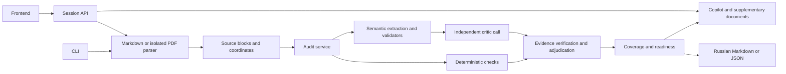

# SpecGuard architecture

The frontend talks to one FastAPI service. The CLI and HTTP audit worker call the same parser and audit function. Audit results, source coordinates, findings and readiness have one Pydantic representation. The exporter derives OpenAPI and standalone JSON schemas from those models.

## Frontend integration

1. Create a session with `POST /sessions`. Retain the opaque token in memory. Send it in the HTTP Authorization header with the Bearer scheme.
2. Upload raw bytes to `POST /documents?filename=...`. Create an audit with its document IDs. The default API mode is offline. Live semantic requests require explicit user consent and server-side provider configuration.
3. Poll `GET /audits/{id}`. The response includes ordered progress events. After completion fetch `/result` and, for download, `/report`. Check `coverage.complete` and `readiness.verdict` separately from job status.
4. Open quoted evidence using the document ID and block ID in its location. Use the provided page number or line range.
5. Attach supplementary context to the audit, explicitly select the attachment IDs for Copilot or comparison, and remove them when finished. Treat revision responses as drafts requiring human review. No endpoint applies a revision.
6. Proxy the API through the frontend development server or serve the UI from the same origin. Keep the backend on loopback. Render all document text and Markdown as untrusted content.

## Boundaries

Local session state is memory-only with a one-hour TTL. Run one server worker. Sessions own source documents and jobs. Each job owns its result, conversation and attachments. Persistent external usage reservations are stored separately in SQLite. The PDF worker receives bytes without the server environment. Linux applies address-space limits. The parent monitors resident memory on macOS and Linux.

The backend compares the account’s authenticated DeepSeek model list against its configured IDs before inference. Source text is passed as untrusted model input. The application checks output schemas, IDs and quotes before producing findings. Missing model results, bounded analysis windows and unreadable sources remain visible in coverage and readiness.

The organizer source audit, requirements matrix and decision record are in [official](official). See the [engineering handoff](handoffs/codex.md) for credentials status, observed tests and branch history.
